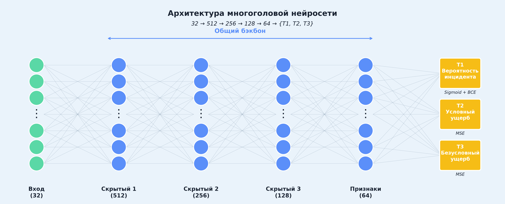
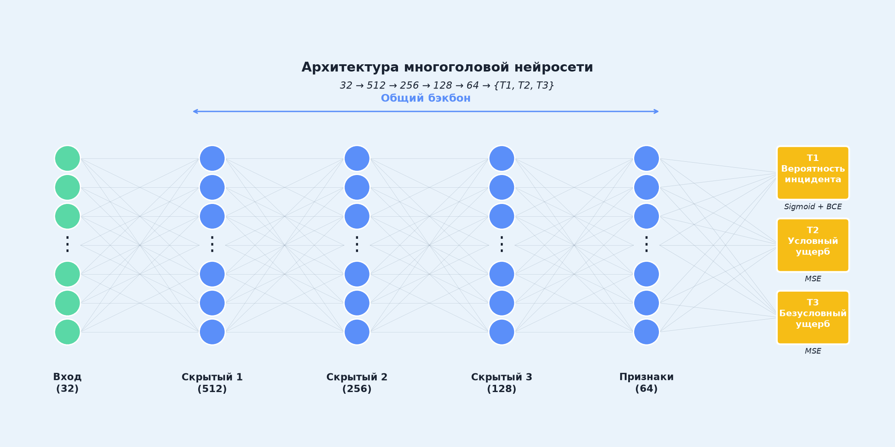

<div align="center">

# 🛡️ AI Insurance Cyber Risk Forecast

### Прогнозирование финансовых потерь от киберинцидентов на основе многоголовой нейросети

[](https://python.org)
[](https://pytorch.org/)
[](https://scikit-learn.org)
[](https://opensource.org/licenses/MIT)

## Change language: [English](README.en.md)

</div>

---

## 📖 О проекте

<div align="justify">

**AI Insurance Cyber Risk Forecast** – исследовательский проект, посвященный разработке системы прогнозирования финансовых потерь от киберинцидентов для страховых компаний. Проект реализует полный пайплайн машинного обучения: от генерации синтетических данных и их препроцессинга до обучения многоголовой нейросети и визуализации результатов андеррайтинга.

Ключевая особенность – **многоголовая архитектура** с общим бэкбоном и тремя специализированными головами, каждая из которых решает свою задачу: оценка вероятности инцидента, прогнозирование условного и безусловного ущерба. Модель обучена на реалистичных синтетических данных, сгенерированных с учетом отраслевых особенностей, корреляций между признаками и нелинейных взаимодействий.

Проект выполнен в рамках научно-исследовательской работы для экономической конференции **«Оценка ущерба от цифрового мошенничества»**.

</div>

---

## ✨ Ключевые возможности

<div align="center">

<table>
    <tr>
        <td valign="top" width="50%">
            <h3 align="center">🧠 Многоголовая нейросеть</h3>
            <p align="center">
                
                
                
            </p>
            <div style="text-align: left; margin-left: 20px;">
                <ul style="text-align: left; padding-left: 20px;">
                    <li>🎯 Голова T1: вероятность киберинцидента (Binary Cross-Entropy)</li>
                    <li>💸 Голова T2: условный ущерб при инциденте (MSE)</li>
                    <li>📊 Голова T3: безусловный ожидаемый ущерб (MSE)</li>
                    <li>⚙️ Общий бэкбон с BatchNorm и Dropout</li>
                    <li>🛡️ Градиентное клиппирование для стабильного обучения</li>
                </ul>
            </div>
        </td>
        <td valign="top" width="50%">
            <h3 align="center">🖥️ Консольное приложение</h3>
            <p align="center">
                
                
                
            </p>
            <div style="text-align: left; margin-left: 20px;">
                <ul style="text-align: left; padding-left: 20px;">
                    <li>🎮 Удобное меню с 9 командами</li>
                    <li>🗃️ Генерация и препроцессинг данных</li>
                    <li>🤖 Обучение и инференс модели</li>
                    <li>📊 Генерация графиков для презентации (4 вида)</li>
                    <li>🎨 Генерация визуализаций для презентации</li>
                    <li>🧪 Запуск тестов pytest из интерфейса</li>
                    <li>🌐 Кроссплатформенность (Windows/Linux/macOS)</li>
                </ul>
            </div>
        </td>
    </tr>
</table>

</div>

---

## 🛠 Технологический стек

<div align="center">

<table>
    <tr align="center">
        <th>Компонент</th>
        <th>Версия</th>
        <th>Назначение</th>
        <th>Бейдж</th>
    </tr>
    <tr align="center">
        <td><strong>Python</strong></td>
        <td>3.10+</td>
        <td>Основной язык</td>
        <td></td>
    </tr>
    <tr align="center">
        <td><strong>PyTorch</strong></td>
        <td>2.0+</td>
        <td>Нейросети</td>
        <td></td>
    </tr>
    <tr align="center">
        <td><strong>NumPy</strong></td>
        <td>1.24+</td>
        <td>Научные вычисления</td>
        <td></td>
    </tr>
    <tr align="center">
        <td><strong>Pandas</strong></td>
        <td>2.0+</td>
        <td>Обработка данных</td>
        <td></td>
    </tr>
    <tr align="center">
        <td><strong>SciPy</strong></td>
        <td>1.10+</td>
        <td>Статистика и распределения</td>
        <td></td>
    </tr>
    <tr align="center">
        <td><strong>Scikit-learn</strong></td>
        <td>1.3+</td>
        <td>Масштабирование и метрики</td>
        <td></td>
    </tr>
    <tr align="center">
        <td><strong>Matplotlib</strong></td>
        <td>3.7+</td>
        <td>Визуализация</td>
        <td></td>
    </tr>
    <tr align="center">
        <td><strong>Seaborn</strong></td>
        <td>0.12+</td>
        <td>Статистическая визуализация</td>
        <td></td>
    </tr>
    <tr align="center">
        <td><strong>PyYAML</strong></td>
        <td>6.0+</td>
        <td>Управление конфигурациями</td>
        <td></td>
    </tr>
    <tr align="center">
        <td><strong>Pytest</strong></td>
        <td>7.0+</td>
        <td>Модульное тестирование</td>
        <td></td>
    </tr>
</table>

</div>

---

## 📊 Документация датасета

### 📋 Параметры (входные признаки)

<div align="center">

<table>
    <tr align="center">
        <th>№</th>
        <th>Параметр</th>
        <th>Обоснование</th>
        <th>Тип данных</th>
        <th>Диапазон / Шкала</th>
    </tr>
    <tr>
        <td align="center"><strong>1</strong></td>
        <td>Годовая выручка (млн руб.)</td>
        <td align="left">Чем выше выручка, тем больше активов под угрозой и выше потенциальные операционные перебои</td>
        <td align="center">Непрерывный</td>
        <td align="center">[0; +∞)</td>
    </tr>
    <tr>
        <td align="center"><strong>2</strong></td>
        <td>Стоимость нематериальных активов (млн руб.)</td>
        <td align="left">Прямая цель кибератак – данные и IP, их стоимость коррелирует с ущербом</td>
        <td align="center">Непрерывный</td>
        <td align="center">[0; +∞)</td>
    </tr>
    <tr>
        <td align="center"><strong>3</strong></td>
        <td>Количество сотрудников</td>
        <td align="left">Влияет на сложность управления доступом, человеческий фактор и затраты на реагирование</td>
        <td align="center">Дискретный</td>
        <td align="center">[1; +∞)</td>
    </tr>
    <tr>
        <td align="center"><strong>4</strong></td>
        <td>Доля онлайн-продаж</td>
        <td align="left">Чем выше цифровизация, тем больше поверхность атаки и зависимость от ИТ-инфраструктуры</td>
        <td align="center">Доля</td>
        <td align="center">[0; 1]</td>
    </tr>
    <tr>
        <td align="center"><strong>5</strong></td>
        <td>Расходы на кибербезопасность за последний год (млн руб.)</td>
        <td align="left">Инвестиции в защиту снижают риск, но могут указывать на сложность инфраструктуры – учитываем как квадратичный эффект</td>
        <td align="center">Непрерывный</td>
        <td align="center">[0; +∞)</td>
    </tr>
    <tr>
        <td align="center"><strong>6</strong></td>
        <td>Количество серверов</td>
        <td align="left">Больше узлов – больше потенциальных точек входа</td>
        <td align="center">Дискретный</td>
        <td align="center">[0; +∞)</td>
    </tr>
    <tr>
        <td align="center"><strong>7</strong></td>
        <td>Доля облачных сервисов в ИТ-инфраструктуре</td>
        <td align="left">Облака имеют свои риски (настройки, доступы), но часто более защищены – нелинейная зависимость</td>
        <td align="center">Доля</td>
        <td align="center">[0; 1]</td>
    </tr>
    <tr>
        <td align="center"><strong>8</strong></td>
        <td>Количество критических бизнес-приложений</td>
        <td align="left">Сбои в них дают максимальный финансовый урон</td>
        <td align="center">Дискретный</td>
        <td align="center">[0; +∞)</td>
    </tr>
    <tr>
        <td align="center"><strong>9</strong></td>
        <td>Количество подключенных IoT/OT-устройств</td>
        <td align="left">Для промышленных компаний – критично, расширяет поверхность атаки</td>
        <td align="center">Дискретный</td>
        <td align="center">[0; +∞)</td>
    </tr>
    <tr>
        <td align="center"><strong>10</strong></td>
        <td>Наличие формальной политики безопасности</td>
        <td align="left">Снижает базовый риск</td>
        <td align="center">Бинарный</td>
        <td align="center">{0, 1}</td>
    </tr>
    <tr>
        <td align="center"><strong>11</strong></td>
        <td>Периодичность внешнего пентеста</td>
        <td align="left">Частота проверок коррелирует с выявляемостью уязвимостей</td>
        <td align="center">Порядковый</td>
        <td align="center">0 – реже раза в год, 6 – раз в полгода, 12 – раз в год, 24+ – более года назад</td>
    </tr>
    <tr>
        <td align="center"><strong>12</strong></td>
        <td>Наличие SOC / SIEM-системы и 24/7 мониторинга</td>
        <td align="left">Ускоряет обнаружение, сокращает время простоя</td>
        <td align="center">Бинарный</td>
        <td align="center">{0, 1}</td>
    </tr>
    <tr>
        <td align="center"><strong>13</strong></td>
        <td>Процент сотрудников, прошедших обучение кибергигиене за год</td>
        <td align="left">Снижает риск фишинга и социальной инженерии</td>
        <td align="center">Доля</td>
        <td align="center">[0; 1]</td>
    </tr>
    <tr>
        <td align="center"><strong>14</strong></td>
        <td>Наличие плана реагирования на инциденты (IRP)</td>
        <td align="left">Уменьшает стоимость ликвидации последствий</td>
        <td align="center">Бинарный</td>
        <td align="center">{0, 1}</td>
    </tr>
    <tr>
        <td align="center"><strong>15</strong></td>
        <td>Отрасль</td>
        <td align="left">Разные отрасли имеют разную частоту и размер ущерба (финансы и здравоохранение – самые дорогие)</td>
        <td align="center">Категориальный</td>
        <td align="center">1 – Финансы, 2 – Ритейл, 3 – Производство, 4 – Здравоохранение, 5 – IT/Телеком, 6 – Другое</td>
    </tr>
    <tr>
        <td align="center"><strong>16</strong></td>
        <td>Объем обрабатываемых персональных данных (млн записей)</td>
        <td align="left">Влияет на штрафы по GDPR/152-ФЗ и репутационные потери</td>
        <td align="center">Непрерывный</td>
        <td align="center">[0; +∞)</td>
    </tr>
    <tr>
        <td align="center"><strong>17</strong></td>
        <td>Количество киберинцидентов за последние 3 года</td>
        <td align="left">Прямой предиктор будущих потерь (инерция риска)</td>
        <td align="center">Дискретный</td>
        <td align="center">[0; +∞)</td>
    </tr>
    <tr>
        <td align="center"><strong>18</strong></td>
        <td>Суммарный ущерб от инцидентов за последние 3 года (млн руб.)</td>
        <td align="left">Если есть – лучший прокси для ожидаемых потерь</td>
        <td align="center">Непрерывный</td>
        <td align="center">[0; +∞)</td>
    </tr>
    <tr>
        <td align="center"><strong>19</strong></td>
        <td>Наличие страхового покрытия киберрисков в прошлом</td>
        <td align="left">Показывает, была ли компания проандеррайтена ранее</td>
        <td align="center">Бинарный</td>
        <td align="center">{0, 1}</td>
    </tr>
    <tr>
        <td align="center"><strong>20</strong></td>
        <td>Размер страховых выплат в прошлом (млн руб.)</td>
        <td align="left">Показывает тяжесть понесенного ущерба</td>
        <td align="center">Непрерывный</td>
        <td align="center">[0; +∞)</td>
    </tr>
    <tr>
        <td align="center"><strong>21</strong></td>
        <td>Наличие сегментации сети</td>
        <td align="left">Без сегментации даже один скомпрометированный компьютер может привести к тотальному параличу всей сети</td>
        <td align="center">Бинарный</td>
        <td align="center">{0, 1}</td>
    </tr>
    <tr>
        <td align="center"><strong>22</strong></td>
        <td>Наличие устаревшего ПО/EOL</td>
        <td align="left">Кратно повышает вероятность успешной атаки и полностью нивелирует эффективность большинства периметровых защит</td>
        <td align="center">Бинарный</td>
        <td align="center">{0, 1}</td>
    </tr>
    <tr>
        <td align="center"><strong>23</strong></td>
        <td>Потери от часа простоя (млн руб.)</td>
        <td align="left">Является прямой монетизацией операционной зависимости бизнеса от ИТ-инфраструктуры</td>
        <td align="center">Непрерывный</td>
        <td align="center">[0; +∞)</td>
    </tr>
    <tr>
        <td align="center"><strong>24</strong></td>
        <td>Максимально допустимое время простоя критических сервисов (в часах)</td>
        <td align="left">Превышение этого времени влечет за собой экспоненциальное нарастание репутационных и договорных штрафов</td>
        <td align="center">Непрерывный</td>
        <td align="center">[0; +∞)</td>
    </tr>
</table>

</div>

### 🎯 Целевые переменные и головы

<div align="center">

<table>
    <tr align="center">
        <th>№</th>
        <th>Параметр</th>
        <th>Обоснование</th>
        <th>Тип данных</th>
        <th>Диапазон / Шкала</th>
        <th>Связь с моделью</th>
    </tr>
    <tr>
        <td align="center"><strong>Y0</strong></td>
        <td>Фактический совокупный ущерб за последние 12 месяцев (млн руб.)</td>
        <td align="left">Корневая целевая переменная (Ground Truth). Именно эта цифра поступает из страховой статистики</td>
        <td align="center">Непрерывный</td>
        <td align="center">[0; +∞)</td>
        <td align="left">Используется для вычисления функций потерь (Loss) для голов T1–T3</td>
    </tr>
    <tr>
        <td align="center"><strong>T1</strong></td>
        <td>Вероятность наступления страхового случая (P_inc)</td>
        <td align="left">Определяет, произойдет ли инцидент в ближайшие 12 месяцев. Учитывает нелинейные эффекты от зрелости защиты (п. 10-14) и внешних факторов</td>
        <td align="center">Бинарная классификация / Логит</td>
        <td align="center">[0; 1]</td>
        <td align="left"><strong>Голова 1</strong>: Sigmoid (Binary Cross-Entropy)</td>
    </tr>
    <tr>
        <td align="center"><strong>T2</strong></td>
        <td>Условный ущерб при наступлении инцидента (Severity)</td>
        <td align="left">Финансовые потери при условии, что атака произошла (исключая нулевые значения)</td>
        <td align="center">Непрерывный (Регрессия)</td>
        <td align="center">[0; +∞)</td>
        <td align="left"><strong>Голова 2</strong>: Линейный выход + экспоненцирование (MSE)</td>
    </tr>
    <tr>
        <td align="center"><strong>T3</strong></td>
        <td>Безусловный ожидаемый ущерб (Pure Premium)</td>
        <td align="left">Рассчитывается как T1 * T2. Это математическое ожидание потерь, на которое накручивается нагрузка (расходы на ведение дела, прибыль)</td>
        <td align="center">Непрерывный (Регрессия)</td>
        <td align="center">[0; +∞)</td>
        <td align="left"><strong>Голова 3</strong>: Отдельная регрессия для кросс-валидации</td>
    </tr>
</table>

</div>

---

## 📁 Структура проекта

```bash
ai-insurance-cyber-risk-forecast/
│
├── cli/
│   ├── commands/                        # Команды консольного приложения
│   │   ├── __init__.py
│   │   ├── base.py
│   │   ├── generation.py
│   │   ├── inference.py
│   │   ├── preprocessing.py
│   │   ├── presentation.py
│   │   ├── tests.py
│   │   ├── training.py
│   │   └── visualization.py
│   │
│   ├── services/                        # Вспомогательные сервисы консольного приложения
│   │   ├── __init__.py
│   │   ├── file_finder.py
│   │   ├── folder_opener.py
│   │   ├── test_registry.py
│   │   └── test_runner.py
│   │
│   ├── __init__.py
│   ├── app.py                           # ConsoleApp - главный цикл
│   ├── menu.py                          # Меню консольного приложения
│   └── utils.py                         # Утилиты вывода и запуска
│
├── configs/
│   ├── generation_config.yaml
│   ├── model_config.yaml
│   └── training_config.yaml
│
├── data/
│   ├── presentation/
│   │   └── presentation_companies.csv
│   │
│   ├── processed/
│   │   └── processed_companies.csv
│   │
│   ├── raw/
│   │   └── synthetic_companies.csv
│   │
│   └── visualization_output/
│       ├── graphs
│       │   ├── 01_probability.png
│       │   ├── 02_damage.png
│       │   ├── 03_risk_map.png
│       │   └── 04_risk_factors.png
│       │
│       └── presentation
│           ├── nn_architecture.png
│           └── nn_training.gif
│
├── logs/
│
├── models/
│   ├── checkpoints/
│   │   └── best_model.pth
│   └── scaler.pkl
│
├── run_scripts/                        # Скрипты запуска процессов
│   ├── __init__.py
│   ├── run_generation.py
│   ├── run_inference.py
│   ├── run_preprocessing.py
│   ├── run_presentation.py
│   ├── run_training.py
│   └── run_visualize.py
│
├── src/
│   ├── data_generation/
│   │   ├── __init__.py
│   │   ├── base.py                     # Базовый класс с общими методами
│   │   ├── binary.py                   # Генерация бинарных признаков
│   │   ├── continuous.py               # Генерация непрерывных признаков
│   │   ├── industry.py                 # Генерация отраслей
│   │   ├── orchestrator.py             # Координатор, собирающий всё вместе
│   │   ├── pentest.py                  # Генерация пентеста
│   │   ├── security.py                 # Генерация расходов на безопасность
│   │   ├── share.py                    # Генерация долевых признаков
│   │   └── target.py                   # Генерация целевой переменной
│   │
│   ├── preprocessing/
│   │   ├── __init__.py
│   │   ├── base.py                     # Базовый класс с общими методами
│   │   ├── encoding.py                 # One-Hot кодирование категорий
│   │   ├── feature_engineering.py      # Инженерные признаки
│   │   ├── loader.py                   # Загрузка данных
│   │   ├── orchestrator.py             # Главный класс, управляющий всеми шагами
│   │   ├── scaling.py                  # Масштабирование (StandardScaler)
│   │   └── target_builder.py           # Формирование целевых переменных
│   │
│   ├── train/
│   │   ├── __init__.py
│   │   ├── dataloader.py
│   │   └── trainer.py
│   │
│   ├── src/utils/
│   │   ├── __init__.py                 # Экспортирует все функции для обратной совместимости
│   │   ├── config.py                   # load_config, save_config
│   │   ├── file.py                     # save_dataframe, load_dataframe, save_pickle, load_pickle
│   │   ├── logging.py                  # setup_logging
│   │   └── seed.py                     # set_seed
│   │
│   ├── __init__.py
│   ├── infer.py
│   └── model.py
│
├── tests/
│   ├── test_data_generation.py
│   ├── test_infer.py
│   ├── test_model.py
│   ├── test_preprocessing.py
│   └── test_train.py
│
├──visualization/
│   ├── plots/
│   │   ├── __init__.py
│   │   ├── base.py                     # Абстрактный базовый класс
│   │   ├── damage.py                   # График ущерба
│   │   ├── probability.py              # График T1
│   │   ├── risk_factors.py             # Факторы риска
│   │   └── scatter.py                  # Карта рисков
│   │
│   ├── presentation/
│   │   ├── __init__.py
│   │   ├── nn_architectural.py         # Рисунок архитектуры нейросети
│   │   └── nn_training.py              # Анимация обучения нейросети
│   │
│   ├── __init__.py
│   ├── dashboard.py                    # Оркестратор
│   ├── data_provider.py                # Синглтон для загрузки предсказаний
│   └── theme.py                        # Цвета, шрифты, стиль
│
├── .gitignore
├── LICENSE
├── main.py
├── README.en.md
├── README.md
└── requirements.txt
```

---

## 🏛️ Архитектура многоголовой нейросети



---

## 🎓 Обучение многоголовой нейросети



---

## 🚀 Быстрый старт

### 📋 Предварительные требования
- Python 3.10 или новее
- Рекомендуется использование виртуального окружения

### ⚙️ Установка и настройка

```bash
git clone https://github.com/MordaRedFox/ai-insurance-cyber-risk-forecast.git
cd ai-insurance-cyber-risk-forecast
python -m venv .venv
source .venv/bin/activate          # Linux/macOS
.venv\Scripts\activate             # Windows
pip install -r requirements.txt
```

### 🖥️ Запуск консольного приложения

```bash
python main.py
```

### 🔧 Запуск отдельных скриптов

```bash
python run_scripts/run_generation.py
python run_scripts/run_preprocessing.py
python run_scripts/run_training.py
python run_scripts/run_inference.py
python run_scripts/run_visualize.py
python run_scripts/run_presentation.py
```

### 🧪 Запуск тестов

```bash
pytest tests/ -v
```

---

## 📩 Контакты
Я открыт для конструктивной критики и предложений по улучшению кода. Если вы нашли ошибку или знаете, как сделать что-то лучше - пожалуйста, свяжитесь со мной!

[](https://t.me/MordaRedFox)
&nbsp;
[](mailto:mordaredfox@gmail.com)
